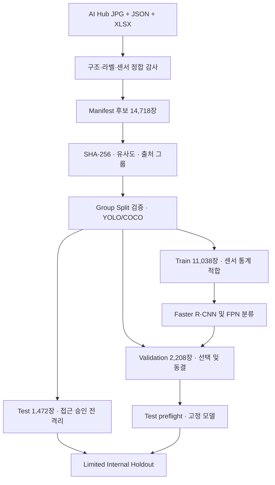
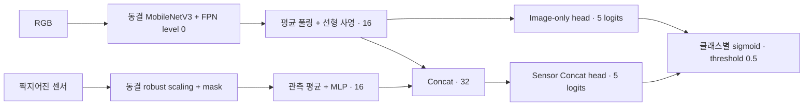
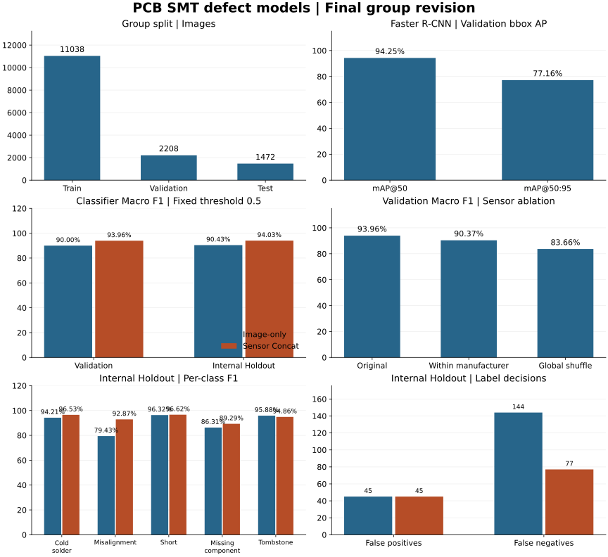

# PCB SMT 결함 탐지와 이미지–센서 융합 최종 연구 보고서

## 1. 연구 개요

표면실장기술(SMT) 검사에서 PCB 이미지의 외관 결함 위치와 종류를 자동으로 식별하면 품질 엔지니어가 재검토할 항목을 우선순위화할 수 있다. 본 연구는 납땜공정의 다섯 결함을 대상으로 (1) 이미지에서 결함 상자와 클래스를 찾는 객체 탐지와 (2) 동일 이미지에서 나타난 결함 종류를 동시에 예측하는 multi-label 분류를 별도 문제로 다룬다. 두 번째 과제는 이미지 외에 캡처 시점에 짝지어진 공정 센서를 사용할 수 있다. 검사 검토 부담과 미검출을 줄이는 것은 현장 적용의 동기다. 실험으로 측정한 것은 AI Hub 데이터의 Validation 및 동일 출처 내부 Holdout 성능이다.

## 2. 연구 질문과 가설

| 연구 질문 | 설계와 근거 |
| --- | --- |
| 이미지에서 결함 유형을 얼마나 판별할 수 있는가? | 센서 공급이 없어도 동작하는 Image-only를 기준으로 삼고, 탐지기가 학습한 FPN 특징을 사용한다. Group Validation과 Holdout에서 클래스별 성능을 측정한다. |
| 공정 신호를 추가하면 판단이 달라지는가? | 같은 탐지기 체크포인트로 초기화한 두 분류기를 같은 분할에서 비교한다. 영상 특징과 측정값의 작은 embedding을 결합하는 feature-level concat은 두 표현의 상호작용을 분류 head에서 학습할 수 있다. |
| 원본 Train/Validation이 관련 샘플을 분리했는가? | SHA-256, 이미지·센서 유사도, 출처·시각·세션 근거를 조사하고 연결된 샘플을 Group Split에서 함께 배정한다. 원본 분할의 탐색 결과와 새 리비전의 성능은 각각 해당 표본에 조건부다. |
| Sensor Concat이 정확한 짝의 센서에 민감한가? | 이미지·라벨·가중치·전처리·threshold를 고정해 원본, 제조사 내 셔플, 전역 셔플을 비교한다. 성능 차이는 입력 개입에 대한 민감도 근거다. |
| Validation에서 선택한 모델의 차이가 다른 표본에도 남는가? | 두 모델과 threshold를 동결한 뒤 같은 1,472개 내부 Test 표본을 한정된 절차로 평가한다. 생산 세션이나 외부 제조 환경에 대한 성능은 별도 근거가 필요하다. |

## 3. 데이터셋과 분할

출처는 AI Hub의 공개 카탈로그 번호 **71900** SMT 납땜공정 데이터다. JPG 이미지와 캡처 기록, 이미지 메타데이터·상자·센서 시퀀스를 담은 JSON, 센서 행을 담은 XLSX를 읽는다. 보존된 두 COCO export의 Train과 Validation 이미지는 모두 512×512였다. 원본 JSON 상자는 절대 픽셀 `[x, y, width, height]`로 읽는다. 센서 행은 timestamp 및 온도(°C), 습도(%), 진동(m/s²), 가속도(g), 소음(dB) 채널을 사용한다. `defect_detected`는 모델 입력, 결측 지표, 정규화 통계 등에 사용하지 않는다. [AI Hub 데이터 접근](data-access.md) · [멀티모달 데이터 계약](multimodal-data.md)

| 결함 | 클래스 키 | AI Hub 범주 | YOLO | COCO |
| --- | --- | ---: | ---: | ---: |
| 냉납 | `cold_solder` | 23 | 0 | 1 |
| 밀림 | `misalignment` | 24 | 1 | 2 |
| 쇼트 | `short` | 25 | 2 | 3 |
| 미삽 | `missing_component` | 27 | 3 | 4 |
| 일어섬 | `tombstone` | 30 | 4 | 5 |

분류 목표 `smt-view-class-presence-v1`은 검증된 상자가 하나 이상 존재하는 클래스를 각각 1로 두는 5차원 벡터다. 한 이미지에 여러 클래스가 공존할 수 있고 탐지 대상 상자가 없는 정상 이미지는 모두 0이다. 원본 Manifest는 15,372개 기록에서 `candidate=14,718`, `hold_review=645`, `exclude=9`를 기록했다. 구조 오류는 제외하고 라벨 불일치, 비대상 결함, 센서 비교 실패, 분할 간 동일 파일이나 파일명은 검토 대상으로 둔다. 데이터 감사와 모델 입력 적격성은 별도 계약이다. 원본 분할의 멀티모달 감사는 후보 중 22건을 분할에 걸친 출처·캡처 그룹 근거로 격리했다. [라벨 정책](../src/ict_pipeline/data/preprocessing/policy.py) · [Manifest](../src/ict_pipeline/data/preprocessing/manifest.py)

| 분할 | AI Hub 후보 | 최종 Group Split | Group COCO 상자 |
| --- | ---: | ---: | ---: |
| Train | 13,062 | 11,038 | 12,645 |
| Validation | 1,656 | 2,208 | 2,567 |
| Test | — | 1,472 | 1,665 |
| 합계 | 14,718 | 14,718 | 16,877 |

AI Hub revision은 `0018e9e0b319bbe9fa8a2bae4aef98796d81838418e52250f5747b4aaa51959a`다. 최종 Group Split revision은 `2553967b4400a43f9f60653c9550f86c48cdb1d983c50c8c506ce48be4f24b55`다. `original_split`은 공급자 배정을 보존하고 `split`은 해당 revision의 역할을 기록한다. 최종 그룹 정책은 `capture`, Validation 0.15, Test 0.10, seed 42이며 이미지·센서 유사도 그룹을 포함했다. 실제 연결 성분은 14,109개였고 가장 큰 성분은 4개 표본이었다. 제조사 4개, source-day 그룹 13개, capture timestamp 그룹 121개가 분할 간에 남았다. 모든 최종 표본의 생산 세션은 미확인 상태다. 제조사와 날짜는 일부 분할에서 공유되는 설명 변수다.

| 검증 항목 | Group verification fingerprint |
| --- | --- |
| Split | `30203c2e7317be2406f822639a4136cfcef9b8a0c0a2b07913dc60c203d28264` |
| Publication | `3f1bb0cf02a4aa988076762cf2021b04ada48ff224a763f424e1b12c98714bdf` |
| Manifest | `4bc49b8c967b7319525ea0ea535a2c94d06556f6d38b43c932ddbfcb937d6d85` |
| Sanitized training cohort | `e47a4c9fe1c8478f428bad7d37897899fa379a08a4cedb79b3e0e266b0bb140e` |
| FrozenValidation | `6709ad94e036670ef0f9f5a370c0caf91d79e3a33f9ef0fa5be7337f8bc824c7` |
| Sensor preprocessing | `845f23e4c04b1676e78d7db8e228f6e75d762db648c259c0cffb59e2e0240ae4` |

근거는 보존 아카이브의 `smt-aihub-sensor-index-v1/audit.json`, 두 split의 `split.json`과 COCO export, 최종 `verification/verification.json`, `limited-internal-holdout/limited-holdout.json`이다. 아카이브 경로와 추가 지문은 [14절](#14-결론과-재현-근거)에 있다.

## 4. 데이터 처리와 무결성



1. **감사와 Manifest.** 파일 구조, stem과 JSON 이름, 이미지 ID와 해상도, 상자·범주와 관계를 점검한다. Manifest는 원본 위치와 후보 결정의 근거를 기록한다. 변환은 후보에서 YOLO 정규화 상자와 COCO 절대 상자를 만들고 변환 검증에서 참조·개수·좌표를 검사한다. 소스 파일을 수정하지 않는다. [데이터 감사](../src/ict_pipeline/data/preprocessing/audit.py) · [변환 검증](../src/ict_pipeline/data/preprocessing/validate.py)
2. **센서 페어링.** 이미지·JSON·XLSX를 동일 stem과 소스 역할로 찾아 정합성을 검증한다. JSON 첫 센서 시각과 이미지 캡처 시각, XLSX의 시계열 길이·시각·값·결측 위치를 비교한다. 이미지 ID와 센서 ID의 숫자 차이는 기록할 수 있다. 원본 공급자 감사에서 시각만으로 추정된 짝은 0건이었다. [정합](../src/ict_pipeline/multimodal/alignment.py) · [센서 판독](../src/ict_pipeline/classification/sensors.py)
3. **누출 근거.** 원본 바이트 SHA-256으로 정확한 동일성을 확인한다. 이미지는 9×8 grayscale 차분 hash의 Hamming 거리 4 이하 및 16×16 RGB thumbnail 평균절대오차 8.0 이하를 함께 사용했다. 센서는 시간창의 시각·결측·값을 비교하고 채널별 절대 허용치 `(0.05, 0.1, 0.001, 0.001, 0.1)`에 `sensor_scale=1.0`을 적용했다. 유사도는 파일 식별 정보가 바뀐 후보도 포착하는 경험적 검사다. [누출 분석](../src/ict_pipeline/data/preprocessing/leakage.py)
4. **분할과 검증.** sample ID, 이미지 SHA-256, 정확한 센서 창, 생산 세션, capture group, source capture, 이미지·센서 유사도 연결로 성분을 만들고 `seeded-group-stratification-v1`로 크기와 클래스 지원을 고려하여 배정했다. 출처와 날짜만으로 전체 제조 환경을 분리하지는 않았다. 발행물은 배정, Manifest, 변환 COCO/YOLO와 그 지문을 연결한다. `verify-group`은 Train/Validation의 원본 바이트·상자와 범위가 지정된 COCO를 확인했고 Test에는 발행 메타데이터를 사용했다. 과거 예약 증빙과 Test 원본 봉인은 별도 문제다. [배정](../src/ict_pipeline/data/preprocessing/split.py) · [리비전](../src/ict_pipeline/data/preprocessing/revision.py) · [Group 검증](group-retraining.md)
5. **동결 전처리.** Group Train만 사용해 각 센서 채널의 중앙값과 IQR을 적합했다. IQR이 0이면 분모는 1이다. 저장 상태는 `missing=mask`, `scaling=robust`, `normalization=none`, `window_seconds=0`이며 이 실험의 창에는 캡처와 같은 시각의 값만 포함된다. 결측은 0과 관측 마스크로 표현하고, `normalized_mean`은 관측값만 평균한다. 짝이 필요한 최종 분류 프로필의 `missing_train`은 `error`다. Validation/Test는 같은 상태를 읽으며 재적합하지 않는다. [센서 전처리](../src/ict_pipeline/multimodal/preprocessing.py)

## 5. 모델 아키텍처

| 계열 | 작동 방식과 역할 | 제약 |
| --- | --- | --- |
| Faster R-CNN + MobileNetV3 Large + FPN | 경량 CNN backbone과 FPN을 사용한 2단계 탐지기다. RPN이 후보 영역을 만들고 ROI head가 배경 포함 분류와 상자 회귀를 수행한다. TorchVision의 RPN objectness·상자 및 ROI 분류·상자 손실을 합산한다. 추론은 클래스·상자·점수를 산출한다. 최종 Group Detector이자 두 분류기의 초기 특징 추출기다. | 영역 제안과 ROI 계산이 필요하고 낮은 Validation loss가 최대 mAP를 보장하지 않는다. |
| YOLO11n | Ultralytics의 경량 단일 단계 모델이다. 다중 해상도 특징에서 상자 및 클래스 점수를 직접 예측한다. native detection loss와 NMS를 사용하며 탐색 비교에 쓰였다. | 빠른 추론을 고려한 후보이며 크기·freeze 정책과 confidence에 따라 P/R이 달라진다. |
| RT-DETR-R18 | ResNet18 기반 CNN과 Transformer encoder/decoder, object query로 상자와 클래스를 출력한다. Transformers backend의 집합 매칭, 클래스와 상자 및 IoU 손실을 사용한다. | 탐색에서 AP 순위 성능과 고정 confidence의 F1이 크게 달랐다. 분류기의 초기화에 사용된 것은 Faster R-CNN이다. |
| RGB grid Image-only 및 Sensor-only | 앞선 실험의 저비용 기준선이다. RGB를 작은 격자로 축소해 선형 사영하고, 센서는 `normalized_mean`과 관측 마스크의 MLP로 표현한다. 각각 단일 모달 embedding에서 logit을 계산한다. | 축소 영상은 작은 부품의 위치·질감 정보를 잃을 수 있다. 단일 센서 창의 평균은 시간 순서를 담지 않는다. |
| Late / gated / concat 탐색 | Late는 모달별 logit 결합, gated는 학습한 gate로 feature 가중, concat은 두 embedding을 붙인 뒤 MLP로 분류한다. 초기 비교에는 전체 결함 유무를 예측한 이진 실험도 포함된다. | 이진 결과와 다섯 클래스 결과를 같은 성능 척도로 비교할 수 없다. |
| 최종 FPN Image-only 및 Sensor Concat | 원본 RGB를 tensor로 변환하고 TorchVision의 정규화·종횡비 보존 resize 및 32배수 padding을 적용한다. 기록된 mean은 `(0.485, 0.456, 0.406)`, std는 `(0.229, 0.224, 0.225)`, size 설정은 640이다. 동결 FPN level `0`의 256채널 특징을 global average pooling하고 학습 가능한 선형층으로 16차원에 사영한다. | 이미지 전역 표현을 분류하므로 자체적으로 결함 위치를 반환하지 않는다. Sensor Concat은 검증된 짝과 동결 상태에 의존한다. |

최종 Image-only는 영상 embedding에서 선형 head로 logit 5개를 생성한다. 프로필의 `fusion.kind=late`는 공통 스키마에 남아 있으며 선택한 출력은 `image` branch다. 최종 Sensor Concat은 관측 평균 5개와 관측 플래그 5개를 MLP(`10 → 32 → 16`, ReLU)에 넣는다. 영상·센서 embedding을 이어 붙인 뒤 `32 → 32 → 5` head를 사용한다. 모델은 시계열 GRU도 지원하지만 이 체크포인트는 GRU를 사용하지 않았다. [Detector 구현](../src/ict_pipeline/models/coco.py) · [모델 프로필](models.md) · [Encoder](../src/ict_pipeline/multimodal/encoders.py) · [Fusion](../src/ict_pipeline/multimodal/fusion.py)



## 6. 알고리즘과 지표

CNN은 공유 필터로 국소 패턴을 변환한다. FPN의 top-down 경로와 lateral connection은 다른 해상도의 의미 특징을 결합한다. 탐지기는 이 구조를 여러 스케일에서 쓰고 분류기는 한 level을 풀링한다. Feature concatenation은 두 벡터의 좌표를 보존하여 후속 head가 지표별 관계를 학습하게 한다.

클래스 `c`의 logit `z_c`를 `p_c = 1/(1+exp(−z_c))`로 변환한다. 분류기는 선택한 branch에서 binary cross-entropy with logits를 사용하며, 개념적 평균 손실은 `−mean(y log p + (1−y) log(1−p))`다. 최종 예측은 각 클래스에 독립적으로 `p ≥ 0.5`를 적용한다. 점수의 확률 보정은 평가 범위에 없다. [모델 손실](../src/ict_pipeline/multimodal/model.py) · [분류 지표](../src/ict_pipeline/evaluation/product.py)

- Precision = `TP / (TP+FP)`, Recall = `TP / (TP+FN)`, F1 = `2TP / (2TP+FP+FN)`. Macro F1은 정의된 클래스 F1의 평균이다. Micro F1은 TP·FP·FN을 먼저 합친다.
- AUROC는 threshold 전 범위에서 TPR과 FPR의 관계를 요약하며, 동점에 0.5를 부여한 양성–음성 순위 확률로 해석할 수 있다. Macro AUROC는 AUROC가 정의된 클래스의 평균이다.
- multi-label confusion matrix는 클래스마다 실제 음성·양성 행과 예측 음성·양성 열을 갖는다. FPR은 `FP/(FP+TN)`이다. 12절 전체 FPR은 클래스 합계에서 계산했다.
- bbox AP는 같은 클래스 예측을 점수 순으로 처리하고, 지정 IoU 이상에서 정답을 한 번씩 매칭한 precision–recall을 101개 recall 지점에서 보간한다. mAP@50은 IoU 0.50의 클래스 평균이고 mAP@50:95는 IoU 0.50부터 0.95까지 0.05 간격 평균이다. 운영점 P/R/F1은 별도 confidence의 영향을 받는다. [탐지 지표 구현](../src/ict_pipeline/evaluation/metrics.py)

데이터 누출은 일반화 성능을 과대평가할 수 있다. 유사한 영상이나 센서 구간이 학습과 검증에 같이 존재하면 점수가 독립 관측에서의 성능보다 높아질 가능성이 있다. 그룹화는 관측된 관계를 제어하므로, 관측되지 않은 생산 세션과 새로운 외부 출처의 분포 차이는 별도 검증이 필요하다.

## 7. 실험 이력

보존된 실행 영수증의 목적·상태에 따라 다음과 같이 정리했다. 탐색 지표는 당시 Validation에서 구한 값이다. 장치·호스트 경로, 원본 샘플 ID와 개별 예측은 공개하지 않는다.

### 7.1 AI Hub 원본 분할 탐지

`detectors/*/<model>/run.json`과 아래 평가 기록을 대조했다. 탐색 모델은 공식 초기화를 사용했고 seed 42, fp32, AdamW였다. 640 주 비교는 batch 2, LR은 YOLO 0.001, Faster R-CNN/RT-DETR 0.0001이다. 대표 640 벤치마크는 공급자 Validation 1,656장, score floor 0.001, confidence 0.25, match IoU 0.5, class-aware NMS IoU 0.7이다. 각 평가는 해당 실행의 best 체크포인트를 사용했다.

| 실험 ID | 목적과 설정 | mAP@50 / mAP@50:95 또는 관측 결과 | 상태 |
| --- | --- | --- | --- |
| 320 및 640 1-epoch pilot | 세 후보의 실행 가능성과 크기별 입력 경로 확인 | 640 `evaluation-640` 기준 YOLO 58.44 / 44.48%, Faster R-CNN 90.55 / 69.15%, RT-DETR 81.36 / 73.67%. 320 후보는 소규모 실행 점검에 사용 | 탐색 |
| `evaluation-10epoch` | 640, 10 epochs 후보 비교 | YOLO 86.88 / 77.40%, Faster R-CNN 94.93 / 76.60%, RT-DETR 81.67 / 73.92% | 탐색 |
| `evaluation-640-threshold-*`, `evaluation-rtdetr10-conf-*`, `reports/rtdetr-conf-*` | RT-DETR의 저점수 운영점 확인 | 640, 10 epochs에서 confidence 0.05/0.10/0.15/0.20의 F1 71.64/76.83/51.45/14.17%. 같은 sweep의 AP는 81.67/73.92%로 일정했다. 320 report의 AP는 85.09/76.76%로 별도 기록 | 탐색 |
| `threshold-10epoch` | YOLO 및 Faster R-CNN의 confidence 변화 검토 | Faster R-CNN은 0.90에서 F1 90.02%. YOLO는 보고된 0.10/0.35/0.50에서 F1 78.88/83.67/82.67% | 탐색 |
| `evaluation-unfreeze3`, `evaluation-yolo-unfreeze10`, `threshold-yolo-unfreeze` | backbone unfreeze 이후 성능 및 운영점 확인 | Faster R-CNN 3 epochs 79.32/56.68%, YOLO 10 epochs 86.26/77.40%. YOLO confidence 0.50에서 F1 80.98% | 탐색 |
| 중단된 탐색 run | 초기 YOLO 320 호환성 및 Faster R-CNN 640 학습 | YOLO는 학습 런타임 로드 실패, Faster R-CNN 10-epoch 시도 중 하나는 non-finite Validation loss로 실패 | 실패 영수증 유지 |

Faster R-CNN은 대표 10-epoch 비교에서 가장 높은 mAP@50을 보였다. YOLO의 mAP@50:95는 해당 비교에서 더 높았다. RT-DETR의 낮은 고정 confidence F1은 threshold 분석을 통해 해석했다. 이 결과는 최종 Group Validation 결과와 다른 평가 표본에서 얻었다.

### 7.2 분류·누출 분석 및 최종화

초기 product 실험은 대부분 CUDA AdamW(0.001, weight decay 0.0001), seed 42, batch 32, 고정 scheduler, threshold 0.5를 사용했다. 5-epoch run은 Validation Macro F1로, 15/30-epoch run은 Macro AUROC로 체크포인트를 선택했다. 아래 AUROC/F1은 선택된 보고서의 클래스 평균이다. 명시한 Group 초기 실험은 11,038/2,208 표본이며, 공급자 이미지–센서 공통 개발 집합은 격리 등을 적용한 Train 13,051장, FrozenValidation 1,645장이다.

| 실험 ID | 데이터·설계와 목적 | 선택 Epoch 및 Validation Macro AUROC / F1 | 상태 |
| --- | --- | --- | --- |
| `sensor-mlp-v1`, `image-only-v1` | Group 초기 revision, 5 epochs. 이진 결함 유무의 단일 모달 기준 | 둘 다 5, Sensor 99.60/97.62%, Image 63.35/76.77% | 탐색, 이진 목표 |
| `fusion-late-v1`, `fusion-gated-v1`, `fusion-concat-v1` | 같은 Group 이진 과제에서 융합 전략 비교, 5 epochs | 모두 5, Late 99.35/96.78%, Gated 99.51/97.12%, Concat 99.64/97.76% | 탐색, 이진 목표 |
| `fiveclass-{sensor,image,concat}-v1` | Group 5-class RGB grid/센서 MLP 기준, 5 epochs | 모두 5, Sensor 70.65/0.11%, Image 67.99/6.68%, Concat 82.85/22.96% | 탐색, 낮은 F1 |
| `fiveclass-concat-{15,30}epoch-v1` | Group RGB grid concat의 학습 길이 변화 | 14 및 30, 각각 88.74/36.68%, 91.96/50.18% | 탐색, FPN으로 대체 |
| `aihub-{sensor,image,concat}-30e-v1` | 원본 분할 5-class 기준. `aihub-threshold-analysis-v1`에서 Validation 클래스별 threshold도 탐색 | 21/29/29, Sensor 71.32/0.00%, Image 77.80/16.77%, Concat 91.90/51.27%. 동일 Validation에서 클래스별 최고 F1의 평균은 34.08/44.21/63.95% | 탐색, threshold sweep은 선택 편향 가능 |
| `aihub-fpn-{image,concat}-30e-v1` | 원본 분할에서 RGB grid 대신 detector FPN으로 30 epochs, batch 8, AdamW, Macro AUROC 선택 | Image 30, 97.98/87.87%. Concat 14, 99.48/94.84% | 탐색, 분할 간 유사도 분석으로 후속 검증 |
| `fpn-generalization-v1` | 위 원본 FPN run의 유사성·제조사·날짜·센서 셔플 분석, seed 42 | 분석 대상에서 이미지 유사도 그룹 43개(Train 52장, Validation 44장). Concat F1 원본 94.84%, 제조사 내 94.55%, 전역 83.59% | 탐색, 개발 집합 |
| Group `detector` / `finalized-detector` | Group 11,038/2,208. scratch Faster R-CNN, 50 epochs 계획. non-finite loss 후 이미 검증된 체크포인트 확정 | 46 완료, 16 선택. 94.25/77.16% bbox mAP | 학습 실패, 선택 가중치 조기 확정 |
| Group `fpn-image-only`, `fpn-sensor-concat` | 같은 Group Train/Validation과 동결 FPN, 30 epochs, batch 1 | 27/15. Validation 98.42/90.00%, 99.53/93.96% | 최종 선정 |
| Group `fpn-analysis` | 같은 Group Validation과 선택된 체크포인트에서 셔플 및 하위 그룹 점검 | 원본/제조사 내/전역 Macro F1 93.96/90.37/83.66% | 최종 Validation 분석 |
| `test-release-preflight-v2` | 발행 분할, 1,472 Test 표본의 고정 계획, 두 체크포인트와 Detector 증빙 검증 | metadata preflight 통과. 신뢰된 과거 public hash index 부재로 strict seal 및 strict final evaluation 차단 | 영수증 보존 |
| `limited-internal-holdout` | 같은 Group Test 1,472장에 고정 모델·threshold 적용 | Macro F1 90.43/94.03%. 초기 원본 split 인식 오류에 대한 수정 기록과 완료된 재개 상태가 있다 | 제한 내부 분석 완료 |

탐색 분류의 선택 지표는 각 `product-models/<run>/run.json`이 가리키는 `validation.json`에서 확인했다. 5-class threshold CSV는 Validation에서 임계값을 검토한 기록이다. 최종 두 모델은 이미 동결된 0.5로 비교했다. 센서 분포 및 그룹별 라벨 빈도 분석은 `sensor-bias-audit-v1/`에 보존되어 있다. 출처·시간대와 라벨 사이의 결합이 센서 성능에 영향을 줄 수 있어 해당 신호를 독립적인 인과 효과로 해석할 수 없다.

## 8. 최종 Detector

최종 모델은 `fasterrcnn_mobilenet_v3_large_320_fpn`의 scratch layout이다. Group COCO Train으로 SGD, LR 0.005, batch 4, image size 640, seed 42, CUDA fp32에서 50 epochs를 계획했다. Epoch 46까지 완료한 뒤 non-finite Validation loss로 종료되었다. 기록된 최저 Validation loss **0.3986949825265438**의 Epoch 16 `best.pt`를 선택했다. 최종화는 원래 failed run을 보존하고 체크포인트 지문·epoch·loss·레이아웃·유한성을 확인한 후 사본과 최종화 영수증을 발행했다. Group Validation 2,208장에서 유한 예측을 확인했다.

| 지표 | 원본 기록 | 표시값 |
| --- | ---: | ---: |
| bbox mAP@50 | 0.9425243151634528 | 94.25% |
| bbox mAP@50:95 | 0.7716352562408668 | 77.16% |

Faster R-CNN best의 raw SHA-256은 `e97df8042559692ee47c0581d1788371eb476ce8640405f6d172a747fdb9b362`다. 최종화 영수증 fingerprint는 `7d1dac6cf9bc9dd3862562d83ddd0409ba50274b67fcd65d57713c1692d286b5`다. 두 FPN 분류기는 같은 원본 초기화 지문과 scratch layout을 사용하며 detector의 객체 탐지 출력 대신 backbone 특징을 읽는다. [조기 최종화 절차](group-retraining.md) · [체크포인트 로더](../src/ict_pipeline/multimodal/fpn.py)

## 9. Image-only 분류

Group Train 11,038장과 FrozenValidation 2,208장을 사용했다. 5절의 RGB tensor 및 FPN level 0을 입력으로 삼는다. CUDA, AdamW LR 0.001, weight decay 0.0001, batch 1, gradient accumulation 1, 상수 scheduler, seed 42에서 30 epochs를 완료했다. 매 epoch Validation의 Macro AUROC로 `best_validation`을 결정했다. **Epoch 27**, threshold **0.5**, Validation Macro AUROC **0.9841890208448587 (98.42%)**, Macro F1 **0.8999758430928338 (90.00%)**였다. 선택 체크포인트 SHA-256은 `e11ed24e308a03d4fce7511e4717373661c8da45cfe4c665fafb459414a8c485`다. [Group 프로필](profiles/group-retraining/fpn-image-only.yaml)

## 10. Sensor Concat 분류

두 모델의 이미지 처리, 개발 split, epoch 예산, optimizer, batch, seed와 선택 지표는 동일하다. Sensor Concat은 짝지어진 센서를 Train 적합 상태로 변환하고 영상 임베딩에 결합한다. 30 epochs를 완료했고 **Epoch 15**, threshold **0.5**, Validation Macro AUROC **0.9952982171148523 (99.53%)**, Macro F1 **0.9395973525726724 (93.96%)**를 기록했다. 선택 체크포인트 SHA-256은 `8191f5686033df34b53ffe9bddb65463a43e2386661adf8072e5893d896f568c`다. Validation에서 Image-only 대비 Macro F1은 약 3.96%p 높았다. [Group 프로필](profiles/group-retraining/fpn-sensor-concat.yaml)

## 11. 센서 ablation

Group Validation 2,208장의 이미지와 라벨, Epoch 15 가중치, 센서 전처리와 0.5 threshold를 고정했다. Seed 42로 센서 기증자만 바꿨으며 두 셔플 모두 2,208개 기증자가 바뀌었다. 제조사 내 셔플은 전체 제조사 구성과 제조사별 센서 분포를 유지하며 짝을 변형하고, 전역 셔플은 제조사 경계도 넘는다.

| 조건 | Validation Macro F1 원본값 | 표시값 | 원본 대비 |
| --- | ---: | ---: | ---: |
| 원본 짝 | 0.9395973525726724 | 93.96% | 0.00%p |
| 제조사 내 셔플 | 0.9036944615709546 | 90.37% | −3.59%p |
| 전역 셔플 | 0.8366237494369606 | 83.66% | −10.30%p |

Sensor 제거는 이 paired 체크포인트에 학습된 Image-only fallback이 없어 건너뛰었다. 셔플은 드물거나 부자연스러운 이미지–센서 조합을 만들 수 있다. 따라서 이 결과는 센서 입력과 pairing에 대한 모델 민감도를 뒷받침한다. 제조 조건의 인과 효과나 다른 공장의 성능을 추정하려면 별도 설계가 필요하다. 원본은 `fpn-analysis/ablation.json`, `ablation.csv`, `analysis.json`이다. [Ablation 계약](multimodal-analysis.md)

## 12. 최종 내부 Holdout

완료된 `limited-holdout.json`을 읽었다. 두 모델은 동일한 Test 1,472장을 동일 클래스 순서와 threshold 0.5로 평가했다. 기록된 추론은 CUDA, batch 1, seed 42였다.

| 지표 | Image-only | Sensor Concat | 변화 |
| --- | ---: | ---: | ---: |
| Macro AUROC | 98.67% | 99.54% | +0.87%p |
| Macro F1 | 90.43% | 94.03% | +3.60%p |
| Micro F1 | 89.77% | 93.63% | +3.86%p |
| False positives | 45 | 45 | 0 |
| False negatives | 144 | 77 | −67 |
| FPR | 0.70% | 0.70% | 0.00%p |

원본 Macro AUROC는 **0.9866771194671596 / 0.9953969150149791**, Macro F1은 **0.9042960640921512 / 0.9403334281545842**, Micro F1은 **0.8976719003789929 / 0.9362591431556949**다. 합산 confusion은 Image-only TP/FP/FN/TN = 829/45/144/6,342, Sensor Concat = 896/45/77/6,342다. 두 FPR은 `45/(45+6342)` 약 0.7046%다. FN은 약 46.5% 줄었다. 이 합계는 표본–클래스 조합의 판정 건수이며, 서로 다른 이미지의 수로 해석할 수 없다.

| 결함 | Image-only F1 | Sensor Concat F1 | 변화 |
| --- | ---: | ---: | ---: |
| 냉납 | 94.21% | 96.53% | +2.32%p |
| 밀림 | 79.43% | 92.87% | +13.45%p |
| 쇼트 | 96.32% | 96.62% | +0.30%p |
| 미삽 | 86.31% | 89.29% | +2.98%p |
| 일어섬 | 95.88% | 94.86% | −1.02%p |

가장 큰 개선은 밀림에서 관찰됐고 일어섬의 F1은 하락했다. Group Validation F1은 90.00/93.96%, 같은 원천의 별도 Test는 90.43/94.03%였다. 두 분할은 구성 및 역할이 다르며 Validation은 모델 선택에 사용했다. 차이는 표본 구성, 클래스 빈도, 운영점 특성의 영향을 받을 수 있다. 별도 외부 검증이나 신뢰구간으로 효과 크기를 확인한 기록은 없다.



## 13. 평가 무결성과 제한

| 필드 | 보존된 값 또는 관측 |
| --- | --- |
| `evaluation_protocol` | `limited_internal_holdout` |
| `evaluation_origin` | `internal_same_source` |
| Test 샘플 / COCO annotation | 1,472 / 1,665 |
| `file_hash_duplicates`, `cross_split_similarity` | 두 목록 모두 비어 있음 |
| `historical_reservation_status` | `unverified` |
| `historical_payload_seal_verified` | `false` |
| `external_independence_verified` | `false` |
| `production_session_independence_verified` | `false` |

Strict Test Release Gate의 metadata preflight는 통과했다. 신뢰된 공개 과거 hash index가 없어 `seal_verification_allowed=false`, `final_evaluation_allowed=false`이고 preflight는 Test payload를 열지 않았다. 별도의 Limited Internal Holdout은 명시적 Test 접근 후 파일 구조, SHA-256, COCO label 대응 및 설정된 누출 증거를 재검증했다. 이때 생성한 payload snapshot의 fingerprint는 `c2501f61a28d335dff51f6023868afefb2cc47431ea6e453bb4d1cbf7d056f32`다. 이 기록의 기준 시점은 평가 당시이며 과거 원본 봉인을 입증할 자료는 없다. 완료된 결과와 재개 상태는 별도로 보존되어 있다. 이 평가가 뒷받침하는 범위는 설정된 점검을 통과한 내부 동일 출처 표본의 성능이다. [Test Release Gate와 Limited Internal Holdout](dataset-integrity.md)

## 14. 결론과 재현 근거

Group Split에서 FPN과 Sensor Concat의 비교는 동일 평가 표본에서 센서를 함께 사용할 때 AUROC, Macro F1, Micro F1이 높고 총 FN이 낮았음을 보여 준다. 저해상도 RGB grid와 단독 센서의 5-class 탐색 결과는 FPN 계열보다 낮았다. 제조사 내 셔플과 전역 셔플의 성능 하락은 검증된 짝의 중요성을 보여 주며 제조사·생산 세션 영향의 분리를 위한 근거는 제한적이다. 실제 검사 후보의 후속 연구에는 독립 공장과 시간대별 평가, 시각 동기화와 센서 결측 시 정책, 일어섬 및 다른 하위 집단의 오류 검토, 운영점의 비용과 추정 불확실성 측정이 필요하다.

출처 경로의 공통 루트는 로컬 읽기 전용 `outputs/final/artifacts/ict-results/`다. 다음의 `G`는 `group-retraining/<최종 revision>/`이다. 경로와 fingerprint는 기존 산출물을 찾고 대조하기 위한 참조다.

| 상대 경로 | 기록 |
| --- | --- |
| `smt-aihub-split-v1/split.json`, `smt-group-split-v1/split.json` | 공급자 분할과 최종 그룹 배정 |
| `detectors/`, `evaluation-*/`, `threshold-*/`, `product-models/` | 초기 실행·평가 영수증, Validation threshold 및 선택된 분류 보고서 |
| `fpn-generalization-v1/`, `sensor-integrity-analysis/`, `sensor-bias-audit-v1/` | 공급자 분할 유사도, 셔플 및 센서 분포 |
| `G/verification/verification.json` | 검증 fingerprint `d032f9bdec1859aae8c00bd4c58354b78a6ba24b62573c21074f5460ad44849d` |
| `G/finalized-detector/*/finalization.json`, `G/product/*/run.json` | 탐지·분류 선택 및 초기화, 8–10절 SHA-256 |
| `G/fpn-analysis/ablation.json`, `G/test-release-preflight-v2/preflight.json` | 센서 개입 및 preflight fingerprint `55e6308367354ef3706fcf309d1c9ad8ebd29eff2033dc9420ac0989516e0145` |
| `G/limited-internal-holdout/limited-holdout.json` | 결과 fingerprint `ecfb30aaf578de534835733befff4846d789ae8f87c6966786e6093e370f5874`, raw SHA-256 `55e88164b2d2c261ec12e2bb022226ab277e0ca70ab9777c2c8e4796eaa39327` |

두 최종 분류 run의 코드 commit은 `109f4c81e8cb91be40ac4a5e16633e4f45686db5`, 코드 fingerprint는 `de21e0b0a3c30df702382d75de0b1a49182cf4fea4080b7e892267a193925971`이다. 기록된 패키지는 PyTorch `2.6.0+cu126`, TorchVision `0.21.0+cu126`, Pillow `13.0.0`, openpyxl `3.1.5`다. 두 모델의 실제 `run.json`은 동일한 초기 Detector SHA-256, 분할과 동결 상태를 연결한다. 재현 절차는 [Group retraining](group-retraining.md), [센서 분석](multimodal-analysis.md), [아티팩트 관리](artifact-management.md)를 따른다.

그림은 기존 JSON 영수증의 집계 필드만 사용한다. Matplotlib이 있는 환경에서 기존 파일과 다른 출력 경로를 선택해 실행한다. 버전 관리된 SVG는 Matplotlib 3.11.2로 생성했다.

```text
python scripts/plot_final_results.py --revision-dir outputs/final/artifacts/ict-results/group-retraining/2553967b4400a43f9f60653c9550f86c48cdb1d983c50c8c506ce48be4f24b55 --out outputs/final-results-reproduction.svg
```

이 문서의 확인 작업은 기록된 지표, 체크포인트 파일 해시 및 보고서 관계를 읽기 전용으로 대조했다. 신규 학습, Test inference, threshold 조정은 이 확인의 범위 밖이다.
